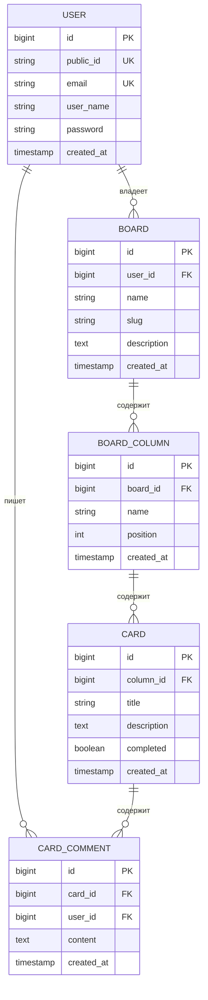

# 📋 Trello Clone — Веб-приложение для управления задачами (Канбан-доска)


Полнофункциональный веб-сервис для управления проектами и личной продуктивностью по методологии Канбан, вдохновлённый популярным сервисом Trello. Приложение построено на базе **Spring Boot**, **Spring Security** и **Thymeleaf** с динамическим интерфейсом на **Tailwind CSS**.

---

## 📑 Содержание

- [✨ Ключевой функционал](#-ключевой-функционал)
- [🛠 Стек технологий](#-стек-технологий)
- [🏛 Архитектурные особенности](#-архитектурные-особенности)
- [🗄 Модель данных](#-модель-данных)
- [🚀 Быстрый запуск](#-быстрый-запуск)
- [📬 Контакты](#-контакты)

---

## ✨ Ключевой функционал

### 👤 Аутентификация и изоляция пространств
- Регистрация и вход пользователей с валидацией через Spring Security Form Login.
- Хэширование паролей с помощью `BCryptPasswordEncoder`.
- **Защита от IDOR (Insecure Direct Object References)**: рабочие пространства изолированы по уникальным `publicId`, предотвращая несанкционированный доступ к чужим доскам по прямому ID.

### 📌 Канбан-доски (Boards)
- Создание, редактирование и удаление досок.
- **Инлайн-редактирование**: изменение заголовка и описания доски «на лету» с контролем изменений (кнопки «Сохранить» / «Отменить»).
- Генерация понятных человекочитаемых URL-адресов (ЧПУ/Slugs) с автоматической транслитерацией кириллицы через библиотеку **ICU4J**.

### 📋 Колонки (Columns / Lists)
- Создание и переименование колонок внутри доски (например, *«К выполнению»*, *«В работе»*, *«Готово»*).
- Горизонтальный скролл с кастомным оформлением полосы прокрутки.
- Каскадное удаление колонок вместе со всеми входящими в них карточками.

### 📝 Карточки задач (Cards)
- Создание карточек задач внутри колонок с указанием названия и описания.
- **Быстрая отметка выполнения**: кнопка-чекбокс с зачеркиванием текста и изменением визуального статуса без перезагрузки экрана.
- **Детальное модальное окно карточки**: просмотр описания, автора, даты создания и цепочки обсуждения.

### 💬 Система комментариев
- Обсуждение задач в реальном времени внутри карточки.
- Разграничение прав на удаление комментариев: удалить комментарий может только его автор либо владелец всей доски.

### 🛡 Обработка исключений
- Централизованный контроллер ошибок (`GlobalExceptionHandler`), перехватывающий `EntityNotFoundException`, `AccessDeniedException` и ошибки валидации.
- Стилизованные страницы ошибок `400`, `401`, `403`, `404` и `500`.

---

## 🛠 Стек технологий

- **Язык**: Java 21
- **Фреймворк**: Spring Boot 4.1.0
- **Безопасность**: Spring Security, Thymeleaf Extras Spring Security 6, CSRF-защита
- **База данных и миграции**: H2 Database (файловый режим с персистентностью), Liquibase
- **ORM / Доступ к данным**: Spring Data JPA, Hibernate ORM
- **Шаблонизатор и UI**: Thymeleaf, Tailwind CSS (интерактивные модальные окна, адаптивная сетка, кастомные скроллбары)
- **Утилиты и библиотеки**:
  - `com.ibm.icu:icu4j` — стандартизированная транслитерация кириллицы в латиницу (BGN standard)
  - `Jakarta Validation` — валидация входных DTO моделей
  - `Lombok` — сокращение бойлерплейт-кода
- **Тестирование**: JUnit 5, Spring Boot Test, MockMvc (интеграционные тесты разграничения доступа)

---

## 🏛 Архитектурные особенности

- **Безопасная маршрутизация**: Маршруты строятся по схеме `/{publicId}/{boardSlug}`, где `publicId` идентифицирует пространство пользователя, а `boardSlug` формируется автоматически из названия доски.
- **Миграции через Liquibase**: Структура таблиц версионируется в XML-чейнджлогах (`/db/changelog/`), а тестовые пользователи загружаются при старте из CSV (`init-user.csv`).
- **Слоистая архитектура**: Четкое разделение ответственности: `Controller` ➔ `Service` ➔ `Repository` ➔ `Entity` с использованием DTO для передачи данных между слоями.

---

## 🗄 Модель данных



---

## 🚀 Быстрый запуск

Приложение использует встроенную базу данных H2, поэтому для локального запуска не требуется предварительная установка внешних СУБД.

### 1. Клонирование репозитория
```bash
git clone https://github.com/RAaDAGoN/Trello.git
cd Trello
```

### 2. Запуск приложения
Соберите и запустите проект с помощью Maven Wrapper:

**Linux / macOS:**
```bash
./mvnw spring-boot:run
```

**Windows (PowerShell / CMD):**
```cmd
mvnw.cmd spring-boot:run
```

Приложение запустится на порту `8080`:  
👉 **http://localhost:8080**

---

### 🔑 Тестовые учетные записи

Благодаря Liquibase в базе уже предзаполнены тестовые аккаунты:

| Email | Пароль | Роль |
|---|---|---|
| `test@mail.ru` | `pas123` | Пользователь |
| `test2@mail.ru` | `pas123` | Пользователь |

> 🛠 **Консоль базы данных H2**: доступна по адресу `http://localhost:8080/h2-console`  
> - JDBC URL: `jdbc:h2:file:./data/mydb`  
> - User Name: `sa`  
> - Password: `password`

---

## 📬 Контакты

- **Автор**: Alex ([RAaDAGoN](https://github.com/RAaDAGoN))
- **GitHub**: [github.com/RAaDAGoN](https://github.com/RAaDAGoN)
- **Проект**: [Trello](https://github.com/RAaDAGoN/Trello)
